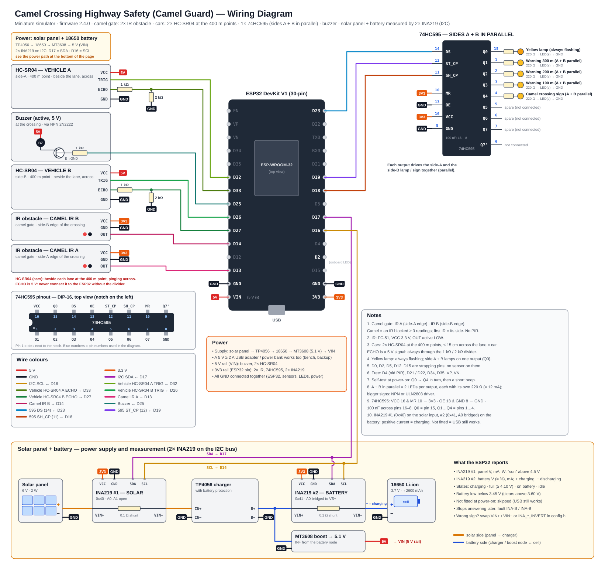

# 🐪 Camel Guard — Sistem Keselamatan Penyeberangan Unta di Highway (ESP32 + Dashboard Lokal)

> 🇬🇧 English version: [README.md](README.md)

> ⚠️ Ini adalah **simulator miniatur** untuk proyek capstone sekolah (maket highway di atas meja dengan mainan
> unta dan mobil). Bukan perangkat untuk jalan sungguhan. Di highway tidak ada pejalan kaki, jadi sistem hanya
> menangani unta.

## 1. Arsitektur

```
 ┌─────────────────────────── ESP32 ────────────────────────────┐   WiFi (HTTP POST tiap 1 dtk)  ┌──── PC / Laptop ─────────┐
 │ Gerbang unta: IR A (tepi sisi A) · IR B (tepi sisi B)         │ ── telemetri JSON ─────────►  │ server.py (Python)       │
 │        ─► IR terhalang = unta, sisi = IR pertama              │                                │  • SQLite: log, hazard,  │
 │ 2× HC-SR04 di titik 400 m sisi A / B (melintang lajur)        │ ◄── perintah: clear/setting ── │    kendaraan             │
 │        ─► mobil lewat? ─► state machine ───────────────────── │     alert / test / reboot      │  • SSE realtime          │
 │  Output: 1× 74HC595 → lampu kuning (selalu berkedip), rambu   │                                │ Browser: dashboard       │
 │          unta, rambu 300 / 200 / 100 m (A + B diparalel),     │                                └──────────────────────────┘
 │          buzzer di penyeberangan                              │
 └──────────────────────────────────────────────────────────────┘
```

**Susunan sensor firmware 2.4.x:** **sensor unta = gerbang unta dengan 2× modul IR obstacle (FC-51, digital) — satu di
tepi sisi A dan satu di tepi sisi B penyeberangan. PIR sudah tidak ada (dihapus di 2.4.0).**
**Sensor kendaraan = 2× HC-SR04 ultrasonik, satu per arah datang di titik "400 m" (sebelum rambu 300 m), di samping
lajur dan memancar melintang lajur** — sensor hanya mendeteksi ada mobil yang lewat di titik itu, bukan mengukur jarak
mobil ke penyeberangan. Tanpa LDR, relay maupun beacon.

**Keputusan peringatan dibuat di ESP32 (edge)**, bukan di PC. Tanpa WiFi/laptop, lampu, rambu dan buzzer tetap
bekerja. Dashboard untuk monitoring, log, dan pengaturan.

| Path | Isi |
|---|---|
| `firmware/camel_guard_esp32/` | Sketch ESP32 (v2.4.0). `sensors_config.h` = pin sensor + default; `config.h` = WiFi, pin lain dan **default boot pertama** (nama sensor lama di sana tidak dipakai lagi); pengaturan dan daftar WiFi tersimpan di flash ESP32 (NVS) dan diubah dari dashboard |
| `dashboard/server.py` | Server dashboard (hanya library standar Python) |
| `dashboard/static/index.html` | Halaman dashboard (Overview / Dashboard / Log & History / Settings / Team) |
| `dashboard/simulator.py` | ESP32 palsu (logika sama dengan firmware) dengan skenario, untuk kerja tanpa hardware |
| `docs/wiring_diagram.svg` | **Diagram wiring** (dibuat oleh `tools/make_wiring.py`) · juga `block_diagram.svg`, `state_machine.svg` (`tools/make_diagrams.py`) |
| `docs/UJI_HARDWARE.id.md` | Checklist pengujian hardware |
| `proposal/` | Draf awal, **proposal lengkap** (`Camel_Crossing_Highway_Safety_Proposal_v3.3.docx`), gambar dan generatornya |
| `START_DASHBOARD.bat` | **Sekali klik**: menulis WiFi laptop ke `config.h` dan membuka dashboard |
| `START_SIMULATOR.bat` | **Simulator sekali klik**: menyalakan dashboard bila perlu dan menjalankan skenario |
| `FIRMWARE_TOOLS.bat` | Compile, compile + upload, cek ESP32 lewat USB, ganti port |
| `camel_guard.ini` | Port proyek (dashboard TCP **5100**, discovery UDP **45811**) dan COM USB per PC |

Port berbeda dari proyek alarm kebakaran (5000 / 45801), jadi kedua dashboard bisa jalan bersamaan di satu laptop.

## 2. Cara kerja

**Highway:** dua jalur (carriageway) — A (lalu lintas dari sisi A, kiri → kanan) dan B (dari sisi B) — dengan satu
penyeberangan unta. Di setiap arah datang: rambu peringatan **300 m, 200 m, 100 m** sebelum penyeberangan, lalu rambu
penyeberangan unta dan lampu kuning peringatan. Sisi A dan B diparalel: satu output menyalakan lampu / rambu kedua sisi. Di maket urutan rambunya benar, tapi jaraknya tidak sesuai skala.

**Gerbang unta (2× IR):** di penyeberangan, IR A mengawasi tepi sisi A dan IR B tepi sisi B. ESP32 membaca keduanya tiap 50 ms:
1. IR yang terhalang **3 pembacaan berturut-turut** (*IR confirmation*, 3 × 50 ms) = **unta terkonfirmasi**, datang dari sisi
   yang IR-nya lebih dulu terpicu (tampil sebagai *From Side A / B*). Dihitung satu kali.
2. Unta ditahan selama IR masih melihatnya, lalu **5 dtk** lagi (*hold time*). Unta yang keluar lewat IR sisi
   lain tetap unta yang sama.

**Sensor kendaraan (HC-SR04) di titik 400 m:** satu per arah datang, sebelum rambu peringatan 300 m (± 400 m sebelum
penyeberangan di dunia nyata, diskalakan di maket), berdiri di samping lajur dan memancar **melintang** lajur. Ini detektor
mobil lewat: lajur kosong terbaca *Lane Empty* (tidak ada benda dalam jangkauan), mobil yang lewat di depannya terbaca
beberapa cm. Masing-masing di-ping tiap 50 ms (A dan B bergantian, selisih 25 ms), pulsa echo diukur dengan interrupt dan
tiap pembacaan melewati filter median-3. Pembacaan **≤ 15 cm** (*Detection Limit (Lane Width)*, 3–150 cm — atur sedikit di
bawah lebar lajur) = mobil. Setiap mobil dihitung untuk sisinya (debounce 0,3 dtk) dan dianggap "mendekat" selama **8 dtk**
(*approach time* — waktu tempuh dari titik 400 m ke penyeberangan). Sama sekali tidak ada pulsa echo = fault sensor.

**Apa yang dipicu oleh deteksi mobil (lampu di samping jalan):** rambu di samping jalan (300 / 200 / 100 m + rambu
penyeberangan unta) **berkedip 1 Hz** selama ada unta di gerbang (atau saat alert manual), ada mobil terdeteksi atau tidak. Mobil yang
melewati sensor 400 m salah satu sisi saat ada unta hanya membuat **buzzer berbunyi** selama approach time (DANGER);
rambu tidak berubah. Mobil tanpa unta di gerbang hanya dihitung.

**Daya (panel surya + baterai):** dua modul **INA219** di bus I2C (D17 = SDA, D16 = SCL) mengukur panel surya
(INA219 #1, alamat 0x40: tegangan dan arus) dan baterai 18650 (INA219 #2, alamat 0x41: tegangan dan arus, + = mengisi).
ESP32 menghitung muatan baterai (≈ %), status pengisian — `charging`, `full` (≥ 4,10 V dan tanpa arus), `discharging`
(memakai baterai) atau `idle` — "sun" (panel ≥ 4,5 V) dan peringatan baterai lemah (di bawah 3,45 V, hilang di atas 3,60 V).
Modul yang tidak dipasang dilewati, jadi perangkat yang dicatu USB tetap bekerja dan hanya tidak menampilkan tile daya.

**Fault** (Settings → Device, catatan merah di halaman Dashboard): `US-A` / `US-B` = HC-SR04 kendaraan sama sekali tidak
memberi pulsa echo selama 1 dtk (sensor, 5 V atau pembagi ECHO), `CAR-A` / `CAR-B` = sensor kendaraan melihat "kendaraan"
selama 2 menit (ada benda di depannya, atau jarak kendaraan diatur terlalu besar), `OBJ-A` / `OBJ-B` = IR unta terhalang
selama 2 menit, `BAT-LOW` = baterai di bawah 3,45 V, `INA-S` / `INA-B` =
INA219 yang tadinya menjawab berhenti menjawab.

| State | Kapan | Lampu kuning | Rambu | Buzzer |
|---|---|---|---|---|
| WARMUP | 3 dtk pertama setelah dinyalakan | berkedip | mati | mati |
| CLEAR | tidak ada unta di gerbang | berkedip | mati | mati |
| WARNING | unta terkonfirmasi di gerbang (IR), atau alert manual | berkedip | **rambu 300/200/100 m berkedip** (1 Hz) + rambu unta | mati |
| DANGER | WARNING **dan** mobil melewati sensor 400 m dalam approach time | berkedip | rambu berkedip 1 Hz (sama seperti WARNING) | bip cepat |

**Lampu kuning peringatan:** satu lampu di gerbang unta yang **selalu berkedip (1 Hz)**, ada unta atau tidak, di semua state.
Sisi A dan B diparalel pada satu output (Q0), jadi kedua lampu berkedip bersama. Tidak ada lagi urutan merah / kuning / hijau.

**Rambu peringatan 300 / 200 / 100 m:** rambu sisi A dan B juga diparalel (satu output per jarak, Q1–Q3, ditambah rambu
penyeberangan unta di Q4). Berkedip 1 Hz selama unta menyeberang, ada mobil terdeteksi atau tidak.
Kedua sensor mobil tetap menghitung mobil per sisi dan memicu DANGER, tetapi tidak lagi memilih sisi mana yang berkedip cepat.

## 3. Wiring (ESP32 DevKit V1)



| Komponen | Pin ESP32 | Catatan |
|---|---|---|
| IR unta A OUT (gerbang, tepi sisi A) | GPIO 13 | FC-51, VCC 3,3 V, aktif LOW |
| IR unta B OUT (gerbang, tepi sisi B) | GPIO 14 | sama |
| HC-SR04 kendaraan A TRIG / ECHO (sisi A, titik 400 m) | GPIO 32 / GPIO 33 | VCC 5 V · **ECHO lewat pembagi 1 kΩ / 2 kΩ** (ECHO → 1 kΩ → pin, pin → 2 kΩ → GND) |
| HC-SR04 kendaraan B TRIG / ECHO (sisi B, titik 400 m) | GPIO 26 / GPIO 27 | pembagi yang sama |
| INA219 #1 (surya, 0x40) dan #2 (baterai, 0x41) SDA / SCL | GPIO 17 / GPIO 16 | VCC 3,3 V, kedua modul di dua kabel yang sama; pad A0 modul #2 dijumper. Lihat jalur daya di bagian bawah diagram wiring |
| Buzzer (di penyeberangan) | GPIO 25 | lewat NPN (2N2222 + 1 kΩ), buzzer aktif 5 V |
| 74HC595 DS / SH_CP / ST_CP | GPIO 23 / 19 / 18 | satu chip: VCC (16) & MR (10) → 3V3, OE (13) & GND (8) → GND, 100 nF |
| Output 74HC595 (sisi A + B diparalel) | – | Q0 lampu kuning · Q1–Q3 rambu peringatan 300 / 200 / 100 m · Q4 rambu penyeberangan unta · Q5–Q7 cadangan (tiap LED dengan 220 Ω sendiri; dua LED per output) |
| LED status | GPIO 2 | onboard: nyala = WiFi terhubung |

Pin dipilih supaya tidak ada sensor di pin strapping (GPIO 0, 2, 5, 12, 15) dan setiap TRIG memakai pin yang bisa output
(GPIO 34–39 hanya input). Dari firmware 2.2: HC-SR04 tetap di pin dan pembagi ECHO yang sama (dipindah dari gantry unta ke
titik 400 m, di samping lajur), modul IR tetap di D13 / D14 (dipindah ke gerbang unta). **Mulai 2.4.0 PIR (D4) dan 74HC595 kedua dihapus:** D4 bebas lagi.

Saat dinyalakan, LED menyala bergantian Q0 → Q4 — self-test wiring.
Bila modul IR bekerja terbalik (HIGH saat terhalang), ubah `CAMEL_IR_ACTIVE_LOW false` di `sensors_config.h`.
Tidak perlu library Arduino tambahan (INA219 dibaca langsung lewat I2C dengan `Wire`).

**Jalur daya** (bagian bawah diagram wiring): panel surya + → **INA219 #1** (VIN+ → VIN−) → charger TP4056 (dengan proteksi baterai)
→ simpul → **INA219 #2** (VIN+ = simpul, VIN− = + baterai) → baterai 18650; konverter boost MT3608 (diatur 5,1 V) mengambil
masukan dari simpul yang sama dan memberi daya ke VIN. Semua ground disambung. Bila arus terbaca dengan tanda terbalik, tukar
VIN+ / VIN− atau ubah `INA_SOLAR_INVERT` / `INA_BAT_INVERT` di `config.h`.

## 4. Mulai

### Tanpa hardware (simulator)
Klik dua kali **`START_SIMULATOR.bat`** dan pilih skenario:

| # | Skenario | Yang terjadi |
|---|---|---|
| 1 | `auto` | tur: kosong → mobil → unta dari A → unta dari B + mobil (DANGER) → … |
| 2 | `clear` | jalan kosong, sesekali mobil |
| 3 | `camel` | unta menyeberang dari sisi A, lalu satu dari sisi B (IR → IR sisi lain) |
| 4 | `danger` | unta menyeberang sementara mobil datang dari dua sisi |
| 5 | `multi` | tiga penyeberangan unta sekaligus (halaman Overview, ALERT ALL) |

Simulator juga memainkan siklus siang / malam 4 menit untuk panel surya dan baterai yang mengisi / mengosong 30× lebih cepat dari
waktu nyata (penyeberangan ketiga skenario `multi` tanpa INA219, seperti perangkat yang dicatu USB).

### Dengan ESP32
1. Sambungkan laptop ke WiFi 2,4 GHz WPA/WPA2-Personal (hotspot HP atau router — bukan WiFi Enterprise sekolah).
2. Jalankan **`START_DASHBOARD.bat`**: WiFi itu ditulis ke `config.h`, aturan firewall ditawarkan (TCP 5100 + UDP 45811),
   lalu `http://localhost:5100` terbuka.
3. Upload firmware: dashboard **Settings → Firmware & Ports → Upload**, atau `FIRMWARE_TOOLS.bat` menu 2, atau
   Arduino IDE (board **ESP32 Dev Module**, core *esp32 by Espressif*).
4. Buka **Settings → Sensors → Sensors Now**: atur potensiometer tiap modul IR (terhalang hanya bila ada benda di gerbang),
   dan atur *Detection Limit (Lane Width)* sedikit di bawah lebar lajur (lajur kosong harus terbaca *Lane Empty*).
   Atur *Vehicle Approach Time* = waktu mobil mainan dari sensor 400 m sampai penyeberangan (default 8 dtk; perangkat yang
   di-update dari 2.2 tetap memakai nilai lamanya).
5. Ikuti [`docs/UJI_HARDWARE.id.md`](docs/UJI_HARDWARE.id.md) untuk pengujian.

Ganti WiFi nanti tanpa upload ulang: **Settings → Network** (maks 5 jaringan), **Configure over USB**
(Chrome/Edge), atau access point cadangan **CamelGuard-Setup-XXXX** (password `camelguard`, halaman http://192.168.4.1).

### Dashboard di cloud (opsional, Render)
`server.py` yang sama bisa berjalan sebagai web service di Render (`render.yaml`): dashboard bisa dibuka dari mana saja, ESP32
mengirim lewat HTTPS. Mode cloud memerlukan `DASHBOARD_PASSWORD` (login) dan `DEVICE_KEY` (dikirim ESP32 sebagai `X-Device-Key`),
keduanya hanya diisi di Render. Langkah lengkap: [`docs/DEPLOY_CLOUD.id.md`](docs/DEPLOY_CLOUD.id.md).

## 5. Dashboard
- **Overview** — satu kartu per penyeberangan unta (yang berbahaya di atas), CLEAR ALL, **ALERT ALL** (peringatan
  manual di semua penyeberangan), jumlah penyeberangan unta / kendaraan hari ini.
- **Dashboard** — status utama (dengan sisi asal unta), **tampilan highway live** (lampu kuning, rambu
  300/200/100 m, rambu unta, gerbang unta dengan IR A / IR B, unta dan sisi asalnya, sensor mobil HC-SR04 di titik
  400 m, mobil dari tiap sisi, buzzer), enam tile, tiga grafik 10 menit (unta, kendaraan, state jalan),
  **tile baterai dan surya dengan empat grafik tambahan (hanya bila INA219 dipasang)**, *Why the system decided this*, kendaraan terakhir per sisi.
- **Log & History** — log kejadian (filter, CSV), **riwayat hazard** (durasi, level puncak, kendaraan), **log kendaraan** (CSV).
- **Settings** — Detection (IR confirmation, approach time, hold time) · Sensors (IR A / IR B saat ini,
  pembacaan HC-SR04, detection limit (lebar lajur), pembacaan INA219, sensor gerbang yang dipasang) · Network ·
  Device · **Output Test** (buzzer, lampu kuning, semua rambu, **tiap LED satu per satu**) · Firmware & Ports · Wiring.
- **Team** — penulis dan pembimbing (diisi dari proposal; bisa diubah di PC dashboard).

Semua pengaturan tersimpan di ESP32 dan dibatasi (clamp) di kedua sisi, jadi nilai yang diketik di browser tidak
bisa membuat sistem "buta". Lampu kuning dan rambu tidak bisa dimatikan; hanya buzzer yang bisa di-mute. Pengaturan firmware
2.0 – 2.3 (daftar WiFi, nama) tetap tersimpan saat 2.4.x di-upload (pengaturan PIR / durasi lampu yang dihapus diabaikan); pengaturan baru mulai dari nilai default.

Data: `dashboard/data/road_log.db` (SQLite).

## 6. Membuat ulang dokumen
- Diagram wiring: `python tools/make_wiring.py docs/wiring_diagram.svg`
- Diagram blok + state machine: `python tools/make_diagrams.py`
- Proposal: `node proposal/make_proposal.js . <nama file>.docx` (sekali saja `npm install docx`)
