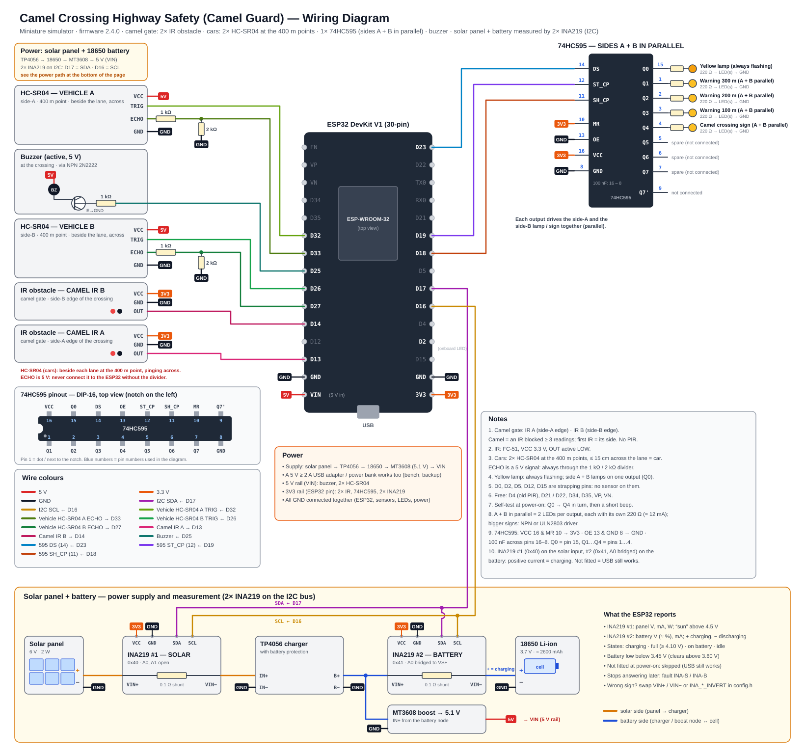

# 🐪 Camel Guard — Camel Crossing Highway Safety System (ESP32 + Local Dashboard)

> 🇮🇩 Versi Bahasa Indonesia: [README.id.md](README.id.md)

> ⚠️ This is a **miniature simulator** for a school capstone project (a table-top highway model with toy camels
> and cars). It is not a device for a real road. A highway has no pedestrians, so the system only deals with camels.

## 1. Architecture

```
 ┌─────────────────────────── ESP32 ────────────────────────────┐   WiFi (HTTP POST every 1 s)   ┌──── PC / Laptop ─────────┐
 │ Camel gate: IR A (side-A edge) · IR B (side-B edge)           │ ── JSON telemetry ──────────►  │ server.py (Python)       │
 │        ─► IR blocked = camel, side = first IR                 │                                │  • SQLite: logs, hazards, │
 │ 2× HC-SR04 at the 400 m point of side A / B (across the lane) │ ◄── commands: clear/settings ── │    vehicles               │
 │        ─► car passing? ─► state machine ─────────────────────►│     alert / test / reboot      │  • live SSE to browser    │
 │  Outputs: 1× 74HC595 → yellow lamp (always flashing), camel   │                                │ Browser: dashboard        │
 │   sign, warning signs 300 / 200 / 100 m (A + B paralleled)    │                                └───────────────────────────┘
 │           buzzer at the crossing                              │
 └──────────────────────────────────────────────────────────────┘
```

**Firmware 2.4.x sensor layout:** **camel sensors = a camel gate with 2× IR obstacle module (FC-51, digital) — one at
the side-A edge and one at the side-B edge of the crossing. There is no PIR any more (removed in 2.4.0).**
**Vehicle sensors = 2× HC-SR04 ultrasonic, one per approach at the "400 m" point (before the 300 m sign), beside the
lane and pinging across it** — they tell that a car is passing that point; they do not measure how far a car is from the
crossing. No LDR, relay or beacon.

**The warning decision is made on the ESP32 (edge)**, not on the PC. Without WiFi or the laptop the lamp,
signs and buzzer keep working. The dashboard is for monitoring, logging and settings.

| Path | Contents |
|---|---|
| `firmware/camel_guard_esp32/` | ESP32 sketch (v2.4.0). `sensors_config.h` = sensor pins + defaults; `config.h` = WiFi, other pins and **first-boot defaults** (its old sensor names are no longer used); live settings and the WiFi list are stored in the ESP32 flash (NVS) and edited from the dashboard |
| `dashboard/server.py` | Dashboard server (Python standard library only) |
| `dashboard/static/index.html` | Dashboard page (Overview / Dashboard / Log & History / Settings / Team) |
| `dashboard/simulator.py` | Fake ESP32 (same logic as the firmware) with scenarios, for working without hardware |
| `docs/wiring_diagram.svg` | **Wiring diagram** (generated by `tools/make_wiring.py`) · also `block_diagram.svg`, `state_machine.svg` (`tools/make_diagrams.py`) |
| `docs/UJI_HARDWARE.id.md` | Bench test checklist (Indonesian) |
| `proposal/` | Original draft, **full proposal** (`Camel_Crossing_Highway_Safety_Proposal_v3.3.docx`), its images and generator |
| `START_DASHBOARD.bat` | **One-click start**: writes the laptop's WiFi into `config.h` and opens the dashboard |
| `START_SIMULATOR.bat` | **One-click simulator**: starts the dashboard if needed and runs a scenario |
| `FIRMWARE_TOOLS.bat` | Compile, compile + upload, check the ESP32 over USB, change ports |
| `camel_guard.ini` | Project ports (dashboard TCP **5100**, discovery UDP **45811**) and USB COM port per PC |

The ports differ from the fire-alarm project (5000 / 45801), so both dashboards can run on the same laptop.

## 2. How it works

**The highway:** two carriageways — A (traffic from side A, left → right) and B (traffic from side B) — with one
camel crossing. On each approach: warning signs **300 m, 200 m, 100 m** before the crossing, then the camel-crossing
sign and a yellow caution lamp. Side A and side B are wired in parallel: one output drives the lamp / sign of both sides. In the model the signs keep their order but not the real distance.

**Camel gate (2× IR):** at the crossing, IR A watches the side-A edge and IR B the side-B edge. The ESP32 reads both every 50 ms:
1. An IR blocked for **3 readings in a row** (*IR confirmation*, 3 × 50 ms) is a **confirmed camel**, coming from the side
   whose IR fired first (shown as *From Side A / B*). It is counted once.
2. The camel is held while an IR still sees it, then **5 s** more (*hold time*). The camel leaving through the
   other IR is the same camel.

**Vehicle sensors (HC-SR04) at the 400 m points:** one per approach, before the 300 m warning sign (≈ 400 m before the
crossing in real life, scaled on the model), standing beside the lane and pinging **across** it. It is a pass-by detector:
an empty lane reads *Lane Empty* (nothing in range), a car passing in front reads a few cm. Each sensor is pinged every
50 ms (A and B take turns, 25 ms apart), the echo is timed by an interrupt and each reading goes through a median-of-3
filter. A reading **≤ 15 cm** (*Detection Limit (Lane Width)*, 3–150 cm — set it a little below the lane width) is a car.
Every car is counted for its side (0.3 s debounce) and is "approaching" for **8 s** (*approach time* — its travel time
from the 400 m point to the crossing). No echo pulse at all is a sensor fault.

**What a car detection does (roadside lamps):** the roadside warning signs (300 / 200 / 100 m + camel-crossing sign) only
**flash at 1 Hz** while a camel is at the gate (or during a manual alert), with or without a car detected. A car passing the
400 m sensor of either side during a camel only makes **the buzzer sound** for the approach time (DANGER); it does not change
the signs. A car with no camel at the gate is only counted.

**Power (solar panel + battery):** two **INA219** modules on the I2C bus (D17 = SDA, D16 = SCL) measure the solar panel
(INA219 #1, address 0x40: voltage and current) and the 18650 cell (INA219 #2, address 0x41: voltage and current, + = charging).
The ESP32 derives the battery charge (≈ %), the charge state — `charging`, `full` (≥ 4.10 V and no current), `discharging`
(on battery) or `idle` — "sun" (panel ≥ 4.5 V) and a low-battery warning (below 3.45 V, cleared above 3.60 V). A module that
is not fitted is skipped, so a USB-powered device keeps working and simply shows no power tiles.

**Faults** (Settings → Device, red note on the Dashboard page): `US-A` / `US-B` = a vehicle HC-SR04 gives no echo pulse at all
for 1 s (sensor, 5 V or ECHO divider), `CAR-A` / `CAR-B` = a vehicle sensor has seen a "vehicle" for 2 minutes (something in
front of it, or the vehicle distance set too high), `OBJ-A` / `OBJ-B` = a camel IR has been blocked for 2 minutes, `BAT-LOW` = battery below 3.45 V, `INA-S` / `INA-B` = an INA219 that answered before
has stopped answering.

| State | When | Yellow lamp | Signs | Buzzer |
|---|---|---|---|---|
| WARMUP | first 3 s after power-on | flashing | off | off |
| CLEAR | no camel at the gate | flashing | off | off |
| WARNING | camel confirmed at the gate (IR), or manual alert | flashing | **300/200/100 m signs flash** (1 Hz) + camel sign | off |
| DANGER | WARNING **and** a car passed a 400 m sensor within the approach time | flashing | signs flash 1 Hz (same as WARNING) | fast beeps |

**Yellow caution lamp:** one lamp at the camel gate that **always flashes (1 Hz)**, camel or not, in every state. Side A and
side B are wired in parallel on a single output (Q0), so both lamps flash together. There is no red / amber / green sequence any more.

**Warning signs 300 / 200 / 100 m:** the signs of side A and side B are also paralleled (one output per distance, Q1–Q3, plus
the camel-crossing sign on Q4). They flash (1 Hz) while a camel is crossing, whether a car is detected or not.
The two car sensors still count cars per side and raise DANGER (buzzer), but they do not change the signs.

## 3. Wiring (ESP32 DevKit V1)



| Component | ESP32 pin | Notes |
|---|---|---|
| Camel IR A OUT (gate, side-A edge) | GPIO 13 | FC-51, VCC 3.3 V, active LOW |
| Camel IR B OUT (gate, side-B edge) | GPIO 14 | same |
| Vehicle HC-SR04 A TRIG / ECHO (side A, 400 m point) | GPIO 32 / GPIO 33 | VCC 5 V · **ECHO through a 1 kΩ / 2 kΩ divider** (ECHO → 1 kΩ → pin, pin → 2 kΩ → GND) |
| Vehicle HC-SR04 B TRIG / ECHO (side B, 400 m point) | GPIO 26 / GPIO 27 | same divider |
| INA219 #1 (solar, 0x40) and #2 (battery, 0x41) SDA / SCL | GPIO 17 / GPIO 16 | VCC 3.3 V, both modules on the same two wires; #2 has its A0 pad bridged. See the power path at the bottom of the wiring diagram |
| Buzzer (at the crossing) | GPIO 25 | via NPN (2N2222 + 1 kΩ), 5 V active buzzer |
| 74HC595 DS / SH_CP / ST_CP | GPIO 23 / 18 / 19 | one chip: VCC (16) & MR (10) → 3V3, OE (13) & GND (8) → GND, 100 nF |
| 74HC595 outputs (side A + B in parallel) | – | Q0 yellow lamp · Q1–Q3 warning signs 300 / 200 / 100 m · Q4 camel-crossing sign · Q5–Q7 spare (each LED with its own 220 Ω; two LEDs per output) |
| Status LED | GPIO 2 | onboard: on = WiFi connected |

The pins were chosen so that no sensor sits on a strapping pin (GPIO 0, 2, 5, 12, 15) and every TRIG is an output-capable
pin (GPIO 34–39 are input-only). Moving from firmware 2.2: the HC-SR04 keep their pins and ECHO dividers (they move from the
camel gantry to the 400 m points, beside the lane), the IR modules keep D13 / D14 (they move to the camel gate). **From 2.4.0 the PIR (D4) and the second 74HC595 are removed:** D4 is free again.

At power-on the LEDs light Q0 → Q4 one after the other — a wiring self-test.
If an IR module works the other way round (HIGH when blocked), set `CAMEL_IR_ACTIVE_LOW false` in `sensors_config.h`.
No extra Arduino libraries are needed (the INA219 is read directly over I2C with `Wire`).

**Power path** (bottom of the wiring diagram): solar panel + → **INA219 #1** (VIN+ → VIN−) → TP4056 charger (with battery protection)
→ node → **INA219 #2** (VIN+ = node, VIN− = cell +) → 18650 cell; the MT3608 boost converter (set to 5.1 V) takes its input from the
same node and feeds VIN. All grounds are connected. If a current reads with the wrong sign, swap VIN+ / VIN− or set
`INA_SOLAR_INVERT` / `INA_BAT_INVERT` in `config.h`.

## 4. Getting started

### Without hardware (simulator)
Double-click **`START_SIMULATOR.bat`** and choose a scenario:

| # | Scenario | What happens |
|---|---|---|
| 1 | `auto` | tour: clear → car → camel from A → camel from B + cars (DANGER) → … |
| 2 | `clear` | empty road, a car now and then |
| 3 | `camel` | a camel crosses from side A, later one from side B (IR → other IR) |
| 4 | `danger` | a camel crosses while cars come from both sides |
| 5 | `multi` | three camel crossings at once (Overview page, ALERT ALL) |

The simulator also plays a 4-minute day / night cycle for the solar panel and a battery that charges and discharges 30× faster than
real time (the third crossing of `multi` has no INA219, like a USB-powered device).

### With the ESP32
1. Connect the laptop to a 2.4 GHz WPA/WPA2-Personal WiFi (phone hotspot or router — not the school Enterprise WiFi).
2. Run **`START_DASHBOARD.bat`**: it writes that WiFi into `config.h`, offers a firewall rule (TCP 5100 + UDP 45811)
   and opens `http://localhost:5100`.
3. Upload the firmware: dashboard **Settings → Firmware & Ports → Upload**, or `FIRMWARE_TOOLS.bat` menu 2, or
   Arduino IDE (board **ESP32 Dev Module**, core *esp32 by Espressif*).
4. Open **Settings → Sensors → Sensors Now**: adjust the potentiometer of each IR module (blocked only when something is in
   the gate), and set *Detection Limit (Lane Width)* a little below the lane width (an empty lane must read
   *Lane Empty*). Set *Vehicle Approach Time* to the time a toy car needs from the 400 m sensor to the crossing (default 8 s;
   a device updated from 2.2 keeps its old value).
5. Follow [`docs/UJI_HARDWARE.id.md`](docs/UJI_HARDWARE.id.md) for the bench tests.

Changing WiFi later needs no re-upload: **Settings → Network** (up to 5 networks), **Configure over USB**
(Chrome/Edge), or the fallback access point **CamelGuard-Setup-XXXX** (password `camelguard`, page http://192.168.4.1).

### Dashboard in the cloud (optional, Render)
The same `server.py` can run as a web service on Render (`render.yaml`): open the dashboard from anywhere, the ESP32 posts
over HTTPS. Cloud mode needs `DASHBOARD_PASSWORD` (login) and `DEVICE_KEY` (the ESP32 sends it as `X-Device-Key`), both set on
Render only. Step by step (Indonesian): [`docs/DEPLOY_CLOUD.id.md`](docs/DEPLOY_CLOUD.id.md).

## 5. The dashboard
- **Overview** — one card per camel crossing (hazards first), CLEAR ALL, **ALERT ALL** (manual warning at every
  crossing), today's camel crossings / vehicles.
- **Dashboard** — hero status (with the side the camel came from), **live highway view** (yellow lamps,
  300/200/100 m warning signs, camel sign, the camel gate with IR A / IR B, the camel and its side, the HC-SR04 car
  sensors at the 400 m points, cars from each side, buzzer), six tiles, three 10-minute charts (camel, vehicles, road state),
  **battery and solar tiles with four more charts (only when an INA219 is fitted)**, *Why the system decided this*, recent vehicles per side.
- **Log & History** — event log (filters, CSV), **hazard history** (duration, peak level, vehicles), **vehicle log** (CSV).
- **Settings** — Detection (IR confirmation, approach time, hold time) · Sensors (IR A / IR B now,
  HC-SR04 readings, detection limit (lane width), INA219 readings, gate sensors fitted) · Network · Device ·
  **Output Test** (buzzer, yellow lamp, all signs, **each LED one by one**) · Firmware & Ports · Wiring.
- **Team** — authors and supervisor (seeded from the proposal; editable on the dashboard PC).

All settings are stored on the ESP32 and clamped on both sides, so no value typed in a browser can make the system
blind. The yellow lamp and signs cannot be muted; only the buzzer can. Settings of firmware 2.0 – 2.3 (WiFi list, name, timings)
are kept when 2.4.x is uploaded (the removed PIR / signal-timing settings are simply ignored); the new settings start at their defaults.

Data: `dashboard/data/road_log.db` (SQLite).

## 6. Regenerating documents
- Wiring diagram: `python tools/make_wiring.py docs/wiring_diagram.svg`
- Block diagram + state machine: `python tools/make_diagrams.py`
- Proposal: `node proposal/make_proposal.js . <file name>.docx` (needs `npm install docx` once)
